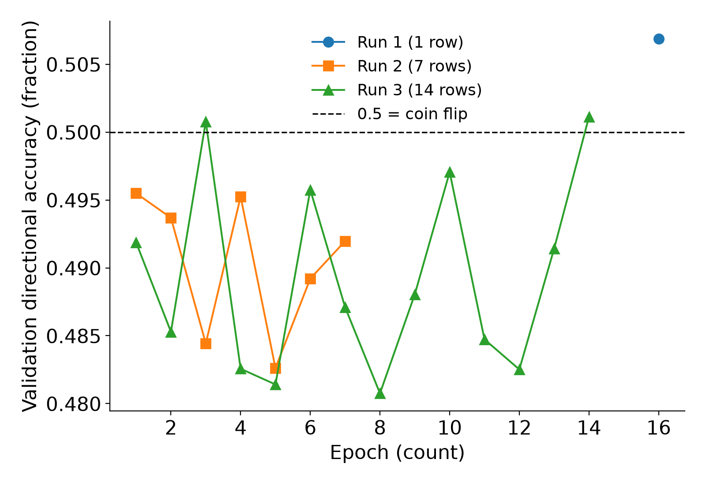
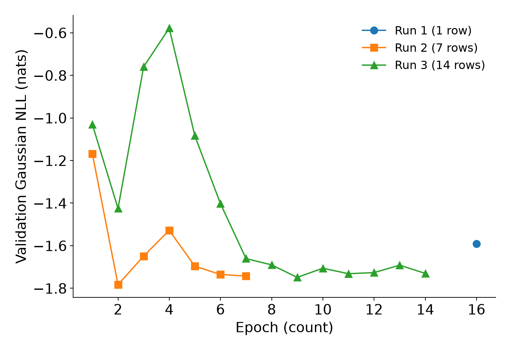

# SHRM: Short-Horizon Return Model

A small probabilistic transformer that predicts a stock's return over the next 35 hourly bars together with its own uncertainty. It is trained with a Gaussian negative log-likelihood loss on hourly data for 14 US tech stocks.

**Results: no  signal was found.** Directional accuracy on the validation set stays at coin-flip level (0.481 to 0.507 across all logged epochs). This repo is a documented negative result, and the sections below say exactly what was and was not measured.

## Results

Every point is one logged epoch, and the colors are separate training runs. The dashed line is 0.5, the accuracy of a coin flip.





| Run | Epochs logged | Best validation NLL | Directional accuracy (min to max) |
|---|---|---|---|
| 1 | 1 (epoch 16 only) | -1.753 | 0.507 |
| 2 | 7 | -1.783 | 0.483 to 0.495 |
| 3 | 14 | -1.749 | 0.481 to 0.501 |

How to read this:

- **Directional accuracy is at chance.** 19 of the 22 logged rows are below 0.5. The three rows above 0.5 are between 0.501 and 0.507.
- **These numbers are, if anything, optimistic.** The validation set was also used for early stopping (patience 5) and for choosing the best checkpoint. The model still does not beat a coin flip on it.
- **The NLL values do not show signal either.** The uncertainty comes from a small separate network that only sees the volatility and drawdown features (see below), so the NLL can improve just by learning how volatile a stock is, with no skill at predicting direction. No baseline NLL (for example a constant mean with the same variance model) was stored, so I cannot say how much of the improvement comes from the predicted mean. The NLL also drops the constant $\tfrac{1}{2}\ln 2\pi$, so it is not comparable with NLL values reported elsewhere.
- **There is no held-out test set.** Only a train and a validation split exist.
- **The log is thin.** `results.csv` has no run ID, seed, timestamp or per-run configuration, so the three runs were separated by where the epoch counter restarts, and I cannot confirm they used identical settings or the same data pull. Run 1 was written by an older version of the logging code that recorded only the last epoch. A snapshot with a header row is in [results/results_log.csv](results/results_log.csv).

## What this project is

Most return-prediction models output a single number. SHRM outputs two: a predicted return $\mu$ and a predicted uncertainty $\sigma$, and it is trained so that $\sigma$ should be large when the prediction is likely to be wrong. The goal was to see whether a transformer over a short window of simple price and volume features could extract a usable edge, and whether the model's own uncertainty carries information.

The answer from these runs is no edge. :(

## How it works

### Data

- **Source:** Yahoo Finance through `yfinance`, 1-hour bars. Data files are not in this repo because Yahoo's terms generally restrict redistributing the data. Fetch them with `scripts/fetch_data.py`.
- **Tickers (sector "tech"):** AAPL, MSFT, GOOGL, META, NVDA, AMD, INTC, CSCO, ORCL, IBM, ADBE, CRM, INTU, SHOP.
- **Local data used:** 2023-12-26 to 2026-11-20, about 5,076 hourly rows per ticker. Because `results.csv` has no timestamps, I cannot say which pull of the data each run used.

### Target

With adjusted close $P_t$ and window $W = 35$ bars, the target is the log return over the next $W$ bars:

$$y_t = \ln\frac{P_{t+W}}{P_t}$$

Thirty-five hourly bars is 35 trading bars, not 35 clock hours, because overnight and weekend gaps fall inside it. Consecutive samples (shifted by one bar) have heavily overlapping targets, so the effective number of independent samples is much smaller than the number of rows.

### Input features

Each sample is a sequence of 70 bars with 4 features per bar. Let $\ell_t = \ln(P_t / P_{t-1})$ be the one-bar log return and $V_t$ the volume.

1. **Price slope.** The least-squares slope of log price against bar index over the last $W$ bars:

$$s_t = \frac{\sum_{i=0}^{W-1}(i-\bar{\imath})\,(\ln P_{t-W+1+i}-\overline{\ln P})}{\sum_{i=0}^{W-1}(i-\bar{\imath})^2}$$

2. **Log volume.**

$$v_t = \ln(V_t + 1)$$

   The price slope and log volume are then standardized per ticker, $z = (x - \bar{x}) / (\hat{\sigma}_x + 10^{-8})$, using that ticker's mean and standard deviation over its full series (see the leakage note below).

3. **Volatility z-score.** First the rolling volatility of one-bar returns, then its z-score against its own recent history, with all rolling statistics over $W$ bars:

$$\sigma^{\text{roll}}_t = \operatorname{std}(\ell_{t-W+1},\dots,\ell_t), \qquad \text{volat\_z}_t = \frac{\sigma^{\text{roll}}_t - \operatorname{mean}_W(\sigma^{\text{roll}})_t}{\operatorname{std}_W(\sigma^{\text{roll}})_t}$$

4. **Drawdown state.** A binary flag that is 1 when the current price is below the highest price of the last $W$ bars:

$$\text{draw\_state}_t = \mathbf{1}\!\left[P_t < \max_{0 \le j < W} P_{t-j}\right]$$

After this, the whole input is standardized per feature with the mean and standard deviation of the training sequences only. Four more features (time-of-day sine and cosine, market-open flag, normalized range) are computed in the code but switched off.

### Model

- **Mean head.** An input projection and learned position embedding feed one transformer encoder layer ($d_{\text{model}} = 32$, 4 attention heads, dropout 0.1, feed-forward size left at the PyTorch default of 2048). The last bar's output goes through dropout and a linear layer to give $\mu$.
- **Uncertainty head.** A separate small network, not the transformer. It reads only the last bar's $\text{volat\_z}$ and $\text{draw\_state}$ and outputs the log variance:

$$\log\sigma^2 = \operatorname{clamp}\big(\operatorname{MLP}(\text{volat\_z}, \text{draw\_state}),\,-12,\,2\big), \qquad \sigma = e^{\frac{1}{2}\log\sigma^2}$$

  The MLP is Linear(2, 16), ReLU, Linear(16, 1).
- **Confidence score.** $c = \dfrac{1}{1 + \sigma / s_y}$, where $s_y$ is the standard deviation of the training targets.

### Loss

Gaussian negative log-likelihood, without the constant term:

$$\mathcal{L} = \frac{1}{N}\sum_{i=1}^{N}\frac{1}{2}\left[\frac{(y_i-\mu_i)^2}{\sigma_i^2} + \ln\sigma_i^2\right]$$

The model is penalized for wrong predictions, but wrong predictions with a large $\sigma$ cost less. It is also penalized for a large $\sigma$ through the $\ln\sigma^2$ term, so it cannot simply claim infinite uncertainty.

### Training and splits

- AdamW, learning rate $2\times10^{-4}$, weight decay $10^{-4}$, gradient clipping at 1.0, batch size 32, up to 50 epochs, early stopping with patience 5 on validation NLL.
- **Split:** chronological and done separately for each ticker, then combined. The first 70% of each ticker's samples are training and the remaining 30% are validation. A gap of 105 samples (sequence length plus horizon, $70 + 35$) is removed from the end of the training portion so that no training target overlaps the validation inputs. Only training batches are shuffled.
- **Leakage note:** the price slope and log volume are standardized with each ticker's full-series mean and standard deviation before the split, so statistics from the validation period leak slightly into the training inputs. The main input scaler and the target standard deviation use training data only. The rolling features only look backward.

## Future steps and open questions

- **Add a held-out test set** that is never used for early stopping or checkpoint choice.
- **Add baselines:** a constant-mean model with the same variance head, and a zero-mean model. This would show how much of the NLL comes from volatility and how much from the predicted mean.
- **Fix the standardization leakage** by fitting the per-ticker scaling on training data only.
- **Save per-sample predictions** to measure rank correlation between $\mu$ and realized returns, return by decile of predicted return, and calibration of $\sigma$.
- **Log run ID, seed, data date range and configuration** with every run so runs can be compared.
- **Open question:** does the uncertainty head carry information that the mean head does not, for example whether realized error grows with $\sigma$?
- **Open question:** would longer history, more tickers, or non-price data change the result?

## Reproduce

```bash
pip install -r requirements.txt
python scripts/fetch_data.py
python scripts/train.py
python make_figures.py
```

`make_figures.py` redraws the two figures above from `results.csv`.